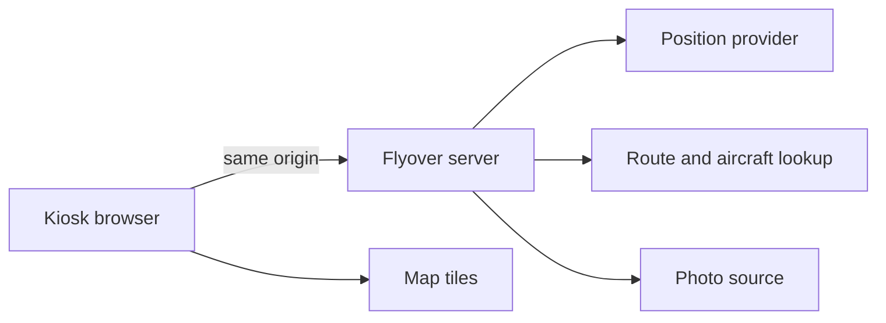

# Technical Requirements Document

**Project:** Flyover
**Version:** 0.3
**Status:** Draft
**Last Updated:** 2026-11-10
**PRD Reference:** [PRD](prd.md)

Terms below were read on 2026-11-10. They are not a legal opinion. The owner confirms them before any provider is enabled. Where a page could not be fetched, the gap is named.

---

## 1. Executive Summary

### Purpose

Describe a v1 Flyover that one household runs as a personal, non-commercial kiosk: one TypeScript process, a gitignored per-host SQLite file, and a manual DNS failover from `webserver1` to `webserver2`.

### Scope

In scope: the shape of the web app, which providers this personal non-commercial deployment may use, the data the server may keep, the UK postcode profile, and the environment and failover requirements for `devserver1`, `stagingserver`, `webserver1`, and `webserver2`.

Out of scope: application code, a second household, host addresses beyond those four names, credentials, a radio receiver, and the traffic cutover the owner has not described.

### Key Decisions

Only the decisions in [decisions.md](decisions.md) are accepted. An ADR below is accepted only when a decision id says so.

- v1 is the API web app for one house. No extra hardware. ([D0001](decisions.md), [D0006](decisions.md).)
- The owner's use is personal and non-commercial. The software licence is MIT. Upstream data terms are not. A commercial fork re-clears every provider. ([D0003](decisions.md), [D0005](decisions.md).)
- The default position provider for this deployment is adsb.lol. OpenSky and the ADS-B Exchange community and RapidAPI plans are ineligible. ([D0009](decisions.md).)
- The profile is a UK postcode and a radius in host config on every serving machine, resolved through postcodes.io, never committed. ([D0007](decisions.md), [D0008](decisions.md), [D0012](decisions.md).)
- One TypeScript process and a per-host SQLite file are accepted ([D0019](decisions.md)). The profile still enters through the host environment ([D0012](decisions.md)). SQLite is gitignored and is not the copy `webserver2` reads.

---

## 2. Project Classification

**Project Type:** web_application

**Classification Rationale:** Flyover serves a browser UI. The browser is the product. A small server exists so that provider credentials and polling stay off the kiosk. That server is part of the same application, not a separate API product. Q1 of the SDLC Studio decision tree (does this serve a web frontend?) is yes.

**Architecture Implications:**

- **Default Pattern:** Monolith, from the web-application row of the pattern matrix. The start-simple rule applies: one owner, one deployment topology, a shared data model, no independent scaling need.
- **Pattern Used:** Monolith (proposed).
- **Deviation Rationale:** None. Microservices, a separate frontend deploy, and serverless are worse fits. A kiosk that polls every few seconds is a long-lived client of one process, not a function with a cold start. Two deployables would double the failover story across `webserver1` and `webserver2` for no current requirement.

---

## 3. Architecture Overview

### System Context



The kiosk never holds an upstream flight-data credential. When the map is drawn, tiles come from MapTiler Cloud ([D0021](decisions.md)). The browser does not call `tile.openstreetmap.org`. The walking skeleton does not draw the map.

### Architecture Pattern

Monolith. One process serves the built UI and the Flyover API.

**Rationale:** The owner runs one application on `webserver1`, with `webserver2` holding the same application for failover. Splitting the UI and the poller would make failover two things that must move together. Internal modules still have boundaries: display, polling, enrichment, photos. Those are packages, not services.

### Component Overview

No paths exist yet. The names are the modules a later story would create.

| Component | Responsibility | Technology | Constraints |
|-----------|---------------|------------|-------------|
| Kiosk UI | List, detail, map, credits, empty and stale states | Browser, current Chromium as the named target | No upstream key. No hover-only control on the live view. Data age visible. Not-for-navigation statement visible. |
| Application server | Profile, poll, cache, same-origin API | Proposed TypeScript, one process | Rate-limit before the provider does. Refuse a provider the configuration has not explicitly enabled. |
| Position adapter | One interface, one enabled implementation | Proposed | Record the source name on every snapshot. Do not call a second provider to fill gaps unless that provider is also explicitly enabled. |
| Enrichment adapter | Airline, flight number, origin, destination, type | Proposed | A cache is not a republished route database. Unknown stays unknown. |
| Photo adapter | Thumbnail URL, credit, link | Proposed | Do not store image bytes. Do not show a photo without the credit and the link. |
| Operator config | UK postcode, resolved centre, radius, secrets | Runtime config or environment on each serving host, outside git | No secret, no postcode, and no home coordinate in the repository. |

---

## 4. Technology Stack

### Core Technologies

| Category | Technology | Version | Rationale |
| ---------- | ----------- | --------- | ----------- |
| Language | TypeScript on Node.js 22 | Node 22 | One language for the page and the poller. Accepted ([D0019](decisions.md)). |
| Framework | Hono | Current 4.x | One small HTTP server in the same process as the poller. The kiosk is a page that process serves. |
| Database | SQLite via `node:sqlite` | Node 22 built-in | Per-host runtime state. Gitignored. Seeded from the host environment. Not a route store and not the profile `webserver2` copies ([D0012](decisions.md), [D0019](decisions.md)). |

Python with FastAPI was the other server. It was declined because the kiosk and the poller would then be two languages. The owner accepted TypeScript ([D0019](decisions.md)).

### Build & Development

| Tool | Purpose |
|------|---------|
| npm | Installs the process dependencies. The lockfile is committed. Secrets are not. |
| Vitest | Runs the acceptance tests. Upstream calls are stubbed. |
| GitHub Actions | Runs that suite on a push to `main` ([D0024](decisions.md)). It does not deploy. |

### Infrastructure Services

| Service | Provider | Purpose |
|---------|----------|---------|
| Development | `devserver1` | Where the owner builds and runs the app |
| Staging | `stagingserver` | The same build, rehearsed before production |
| Production | `webserver1` | The live display |
| Production failover | `webserver2` | The same release, used when `webserver1` is unavailable |

No container platform and no secret store is named. The owner changes DNS by hand when failing over ([D0020](decisions.md)). Secrets stay in the host environment ([D0023](decisions.md)).

---

## 5. API Contracts

### API Style

REST with JSON, between the kiosk and the Flyover server only. Upstream providers stay behind the server. OpenAPI is the documentation form when the server exists. Not built.

### Authentication

No end-user account. The kiosk calls same-origin routes. The live view answers only a client on the home LAN ([D0018](decisions.md)). Upstream credentials are server configuration.

### Endpoints Overview

Illustrative. Not a commitment to paths.

| Method | Path | Description | Auth |
|--------|------|-------------|------|
| GET | `/` | The kiosk page | Home LAN only ([D0018](decisions.md)) |
| GET | `/api/snapshot` | Last accepted poll: aircraft, age, source name, credits, empty or stale or degraded | Home LAN only |

### Error Response Format

```json
{
  "error": {
    "code": "ERROR_CODE",
    "message": "Human-readable message",
    "details": {}
  }
}
```

Provider failures are not this error. A dead upstream is a successful snapshot response with a stale or degraded flag, so the kiosk can keep painting. This envelope is for Flyover's own refusal (bad profile, provider not enabled).

---

## 6. Data Architecture

### Data Models

#### Display profile

| Field | Type | Constraints | Description |
|-------|------|-------------|-------------|
| postcode | text | One UK postcode | The house. Personal data. Host config only |
| latitude | number | -90 to 90 | Centre from postcodes.io. Not invented if the lookup fails |
| longitude | number | -180 to 180 | Centre from postcodes.io |
| radius_miles | number | Greater than 0. Default 15 | Great-circle statute miles ([D0014](decisions.md)) |

#### Aircraft snapshot

| Field | Type | Constraints | Description |
|-------|------|-------------|-------------|
| icao24 | text | From the feed | Stable aircraft id when present |
| callsign | text | Nullable | As broadcast |
| latitude, longitude | number | Required to be listed | Last accepted position |
| altitude_ft | number | Nullable. The feed value `ground` stays ground, not a guessed 0 | Feet ([D0014](decisions.md)) |
| ground_speed_kt | number | Nullable | Knots ([D0014](decisions.md)) |
| heading | number | Nullable | Track, if the feed has it |
| observed_at | timestamp | Required | When the source observed it |
| source | text | Required | Which provider |

Not stored as history. The server keeps the latest poll.

#### Enrichment cache

| Field | Type | Constraints | Description |
|-------|------|-------------|-------------|
| key | text | Identifier or callsign | Lookup key |
| airline, flight_number, origin, destination, aircraft_type | text | Each nullable | Absent means unknown |
| fetched_at | timestamp | Required | So a stale row can be dropped |
| source | text | Required | Which lookup |

Route rows are not this cache. [D0010](decisions.md) discards the adsbdb response after the screen has used it. A Planespotters JSON body may be kept in memory for at most 24 hours ([D0011](decisions.md)) and is not a photo file. Planebase aircraft rows are not cached because those terms were not read.

### Storage Strategy

| Data Type | Storage | Rationale |
|-----------|---------|-----------|
| Profile | Host environment on each serving host, then this host's gitignored SQLite | [D0012](decisions.md), [D0019](decisions.md). `webserver2` has its own environment and its own database file. Neither is committed |
| Latest poll | This host's SQLite, one row | A history is a different product. A restart can still show the last picture and its age |
| Route lookup | Not stored | [D0010](decisions.md). Shown, then discarded |
| Photo JSON | Memory, at most 24 hours | [D0011](decisions.md). Not the image bytes |
| Photo bytes | Not stored | The display loads the thumbnail URL itself |
| Secrets | Host environment or a file outside the repo | Never in git |

### Migrations

The schema is created by the process on startup. There is one profile row and one snapshot row. A later change ships with the build that reads it. No migration framework.

---

## 7. Integration Patterns

### External Services

Re-read on 2026-11-10 against a personal, non-commercial, one-house deployment ([D0005](decisions.md)). "Eligible" means the published terms allow that use. It is not a grant to a commercial fork. A fork used commercially re-clears every row itself.

| Service | Purpose | Protocol | Auth | What the terms say for this use | Verdict for the owner's deployment | Attribution |
|---------|---------|----------|------|--------------------------------|------------------------------------|-------------|
| [adsb.lol API](https://www.adsb.lol/docs/open-data/api) | Live positions | HTTPS JSON, base `https://api.adsb.lol` | Optional key. A key may later be required and is obtained by feeding | ODbL 1.0, stated on the docs page. ODbL allows the screen to show a produced work. Share-alike applies to a publicly used derivative database, not to the kiosk picture. Rate limits are dynamic. No fixed number is published. Production users are asked to make contact | **Eligible. This is the default position provider** ([D0009](decisions.md)). Configuration must still name it before a call. It is a volunteer service and can change or go away | ODbL attribution. Credit adsb.lol and keep the licence notice |
| [OpenSky Network](https://opensky-network.org/about/terms-of-use) | Live positions | REST, documented at the [REST API manual](https://openskynetwork.github.io/opensky-api/rest.html) | Anonymous by IP, or an account. Anonymous is current data only, 10-second resolution | The terms grant non-profit research and non-profit education only. They require a previous written licence for operational REST API use in any live product, service, or automated system, even for a non-profit. Anonymous quota remains 400 credits per day for `/states`. A small box costs 1 credit | **Ineligible, including for this non-commercial live display.** A kiosk that polls OpenSky is the operational use the terms name. Non-commercial does not remove the written-licence requirement. Do not enable it | Not used. If a written licence is later obtained, cite Schäfer et al., IPSN 2014, and opensky-network.org |
| [ADS-B Exchange](https://www.adsbexchange.com/community/developer-hub/) community / RapidAPI | Live positions | REST via RapidAPI | API key. The developer hub describes a personal-use plan at a price that was not re-copied here | The RapidAPI licence grant, retrieved 2026-11-10, is personal non-commercial research, non-profit education, or commercial internal testing that is non-production, time-limited, and not customer-facing. Redistribution, resale, and sublicensing are prohibited. Marketing on the developer hub calls the same API suitable for hobby projects. That sentence is not the grant | **Ineligible for an always-on display.** A household kiosk is not research, not education, and not time-limited non-production testing. The marketing line does not widen the grant. Enterprise would be a separate contract this project does not hold | Not used |
| [adsbdb](https://www.adsbdb.com/) | Airline, flight number, origin, destination | HTTPS JSON `https://api.adsbdb.com/v0/` | None for reads | Route data is the work of David Taylor and Jim Mason and may not be copied, published, or incorporated into other databases without David J Taylor's permission. Non-commercial use does not lift that notice. In a rolling 60 seconds, 512 or more requests are blocked for 60 seconds, and 1,024 or more for 300 seconds. Aircraft data on the same site is credited to Planebase. Those terms were not read. airport-data photos were not read | **Eligible only as a live lookup that is shown and discarded** ([D0010](decisions.md)). **Ineligible as a cache or a route database.** Planebase and airport-data are not sources | Credit David Taylor, Jim Mason, and adsbdb on the screen when a route is shown |
| [Planespotters photo API](https://www.planespotters.net/photo/api) | Airframe photo | HTTPS JSON `https://api.planespotters.net/pub/photos/hex/{hex}` or `/reg/{registration}` | None. Free and keyless | The API page loaded on the second read, 2026-11-10. Visible photographer credit. An obvious path to the returned `link` URL: a plain anchor without `rel="nofollow"` on a clickable browser, or a QR code or NFC tag on a display that cannot be clicked. The URL as text does not qualify. The display fetches thumbnail URLs unchanged. No storing, re-hosting, or proxying of image bytes. JSON cache at most 24 hours. Server-side calls need a descriptive User-Agent with a contact URL or email. Not for training models. Not for resale as an API | **Eligible when those conditions are met, and off until configuration enables it** ([D0011](decisions.md)). Personal non-commercial use adds no extra right. A commercial fork must meet the same page itself | Photographer name beside the image, and the path back to the photo page |
| [postcodes.io](https://postcodes.io/docs/licences/) | UK postcode to a centre, once when the postcode is loaded | HTTPS JSON | None | Software is MIT. Great Britain postcode data is OS OpenData. The licences page requires the Ordnance Survey, Royal Mail, National Statistics, and NRS attribution statements (copyright year 2025 on the page read). Northern Ireland postcodes beginning BT are free for non-commercial use under the ONSPD terms. Commercial use of BT data needs a licence from NI Land & Property Services | **Eligible for this deployment**, including a BT postcode, because the owner's use is non-commercial ([D0008](decisions.md)). Do not download the postcode directory into the repo. A commercial fork that resolves BT postcodes needs the LPS licence. One lookup, not a poll | The four attribution lines from the licences page, on the screen |
| [MapTiler Cloud](https://www.maptiler.com/cloud/pricing/) | Basemap, when the map story is built | HTTPS, MapTiler SDK session or tile API | `MAPTILER_API_KEY` in the host environment, never in git | Free plan read 2026-11-10: personal and non-commercial use and proof of concept, not commercial use. 5,000 map sessions a month. A session is one page load with unlimited interaction after that. A third-party SDK counts tile requests, capped at 100,000 a month. The free quota pauses until the next month rather than billing. Free use must show the MapTiler logo linking to maptiler.com and the text attribution. Terms: https://www.maptiler.com/terms/cloud/ | **Eligible for this personal kiosk** ([D0021](decisions.md)). A paused quota degrades the map. No fallback to `tile.openstreetmap.org`. The key is not committed. The map is not part of the walking skeleton | MapTiler logo and text attribution on the map |
| Local `dump1090` / `readsb` | Positions from a receiver in the house | Not in v1 | — | Future adapter only | Out of scope for this version | Not applicable in v1 |

No other flight API is a candidate. A contracted feed would be a new decision.

### Event Architecture

None. The server polls. The kiosk polls the server, or the server pushes over one connection later if polling the server proves noisy. Polling is enough for v1 and is easier to test. A push channel is not a requirement.

### Risks, called out together

1. **OpenSky stays ineligible.** Operational use of the REST API in a live product needs a written licence even when the operator is non-commercial. Using it here is a licence breach.
2. **ADS-B Exchange's community grant is research, education, or time-limited testing.** An always-on hobby screen does not fit that grant, however non-commercial it is. The developer-hub hobby sentence is not the licence.
3. **adsb.lol is the default and it is still one volunteer service** with dynamic limits. The owner should tell the project before a production kiosk depends on it. It can go away.
4. **ODbL share-alike is about a database, not about the screen.** Publishing derived positions would obligate that database's licence. v1 does not publish one.
5. **adsbdb routes cannot be cached.** Personal use does not create permission to copy them into another database. The allowed shape is show, then discard.
6. **Photos are other people's copyright.** The API page allows a credited thumbnail with an obvious path back. Re-hosting, dropping the credit, or hiding the link fails the terms.
7. **The postcode is the household.** It and the centre stay in host config. A tight bounding box sent upstream is close to the house. Do not log the postcode or the centre on the poll path. Do not commit either.
8. **MIT does not flow upstream, and this eligibility set does not flow to a fork.** README and the credits on the screen have to say so. A commercial fork is the forker's responsibility ([D0005](decisions.md)).
9. **postcodes.io is a lookup, not a directory we own.** Vendor the centre for this one house in host config after a successful lookup. Do not vendor the national file.


---

## 8. Infrastructure

### Deployment Topology

One build. The owner runs that build on each server. Production traffic uses `webserver1`. `webserver2` runs the same release and is the failover. Nothing in this document invents an IP, a DNS name, a port, or a credential.

The kiosk is not deployed by Flyover. It is a browser the household points at the URL.

### Environment Strategy

| Environment | Purpose | Characteristics |
| ------------- | --------- | ----------------- |
| Development | Build and try the app | Host `devserver1`. Disposable data. No production provider key unless the owner deliberately uses one |
| Staging | Rehearse the release | Host `stagingserver`. Same artefact as production. Not the live screen |
| Production | The display the household watches | Host `webserver1` |
| Production failover | Stand-in when `webserver1` is down | Host `webserver2`. Same release as `webserver1` |

Promotion is dev, then staging, then the production pair. The owner triggers production. The skill's deploy step is not authorised to do it, and this TRD does not give it a command.

### Failover

Version 1 failover is a manual DNS change ([D0020](decisions.md)). There is no automatic cutover. This runbook is the procedure. It does not name an IP, a DNS vendor, a port, or a credential, and following it is the owner's job. This repository does not deploy.

1. `webserver1` and `webserver2` run the same Flyover build.
2. `webserver2` has the same host environment as `webserver1`: the UK postcode, the radius, the position-provider name, and any key. It has its own SQLite file, created on that host and not copied from `webserver1`.
3. The owner checks the display by opening Flyover on `webserver2` from a device on the home LAN. A public client is refused ([D0018](decisions.md)).
4. The owner changes the household DNS name so it points at `webserver2` instead of `webserver1`. The kiosk keeps using that name.
5. To return, the owner points the same DNS name back at `webserver1`.
6. The postcode, the centre, and any key stay in the host environment. They are not pasted into git, into this runbook, or into a ticket while the switch is made.

A failed upstream still does not need this procedure. The screen shows empty, stale, or degraded on whichever host is serving.

### Scaling Strategy

Vertical, in the trivial sense: one process on one host is enough for a handful of kiosks reading one cached poll. Do not add a second service to scale. The upstream rate limit is the scaling constraint that matters, and caching the poll is how one kiosk and three kiosks cost the same upstream calls.

---

## 9. Security Considerations

### Threat Model

| Threat | Likelihood | Impact | Mitigation |
|--------|-----------|--------|------------|
| Provider key committed or sent to the browser | Medium if someone is careless | High. The key is the quota, and sometimes the licence | Keys only in host config. Browser talks to Flyover. Review any client bundle for the key |
| Home postcode or centre in git, logs, or a too-tight upstream box | Medium | High. It is the household | Do not log the postcode or the centre on the poll path. Query a box, not the postcode. No postcode and no coordinate in git |
| Live view opened from the public internet | Medium if the proxy is published | High. The map shows where the house is | The process admits only loopback, private LAN addresses, and a loopback reverse proxy whose forwarded client is also on the LAN ([D0018](decisions.md)) |
| Stale or empty feed shown as live | High, because feeds fail | Medium. The household trusts a lie | Age on screen. Distinct empty, stale, and down states. PRD feature "Honest emptiness" |
| Photo or route used outside its terms | Medium | High, legally | Routes are not stored ([D0010](decisions.md)). Photo bytes are not stored ([D0011](decisions.md)). OpenSky and ADS-B Exchange are not enabled |
| Treating the screen as navigation | Low technically, high if the copy is casual | High | The not-for-navigation statement is a requirement, not a footer afterthought |

### Security Controls

| Control | Implementation |
| --------- | ---------------- |
| Authentication | No end-user account. Upstream auth stays on the server. The live view is LAN-only ([D0018](decisions.md)) |
| Authorisation | One operator, one house. No roles and no second profile |
| Encryption at rest | The profile is a location in the host environment and in a gitignored SQLite file. Disk encryption of the host, if any, is the owner's existing practice and is not invented here |
| Encryption in transit | TLS terminates at the reverse proxy on the serving host ([D0023](decisions.md)). Flyover listens for HTTP behind that proxy. Upstream calls are HTTPS |

The working assumption is the UK GDPR household exemption ([D0022](decisions.md)). It is a default the owner can revisit, not a legal opinion. Publishing the display, adding a household, or making it commercial reopens it. The engineering consequence stands either way: collect only the location the display needs, do not send the postcode upstream, and do not keep a history of who looked at the screen.

---

## 10. Performance Requirements

### Targets

Accepted defaults ([D0016](decisions.md)). The stale threshold is configurable. They are not a benchmark result.

| Metric | Target | Measurement |
| -------- | -------- | ------------- |
| Snapshot freshness on screen | Within 15 seconds of a successful poll | Time from the server accepting a poll to the kiosk showing it, on the named browser |
| Stale label | Older than 60 seconds | The age shown on the screen, from `observed_at` |
| Poll cost | Inside the enabled provider's published limit, with margin | Count of upstream calls per minute against that provider's documented threshold |
| Availability | No percentage | A failed upstream still paints empty, stale, or degraded. Failover is a hosting requirement, not this number |

---

## 11. Architecture Decision Records

Accepted where the decisions log says so.

### ADR-001: One deployable web application

**Status:** Accepted ([D0019](decisions.md))

**Context:** The architecture guide's default for a web application on a small team is a monolith. Flyover has one UI, one poller, and two hosts that must run the same thing.

**Decision:** One process serves the UI and the API. Modules communicate in-process.

**Consequences:**

- Positive: Failover copies one build. One test suite. Credentials stay in one place.
- Negative: The UI and the poller ship together even when only one changed.

### ADR-002: adsb.lol is the position provider, and nothing calls until config names it

**Status:** Accepted ([D0009](decisions.md), [D0003](decisions.md))

**Context:** Re-assessed for personal non-commercial use. OpenSky still needs a written licence for a live poll. The ADS-B Exchange community grant does not cover an always-on display. adsb.lol is ODbL.

**Decision:** The owner's deployment enables adsb.lol. The configuration must name it before any call. OpenSky and the ADS-B Exchange community and RapidAPI plans are not enabled. A fresh checkout with no config calls nobody.

**Consequences:**

- Positive: The default is a source the terms allow for this use. The app cannot boot into OpenSky.
- Negative: adsb.lol is a volunteer service. A commercial fork must make its own choice.

### ADR-003: Do not store a position history in v1

**Status:** Proposed

**Context:** A trail is attractive and turns the server into a database of movements. ODbL share-alike and retention both get sharper once that database is kept or published. Route rows are already forbidden as a store by [D0010](decisions.md).

**Decision:** Keep the latest poll in memory. Do not write route rows at all. A Planespotters JSON body may sit in memory for at most 24 hours and is not an export.

**Consequences:**

- Positive: Failover loses nothing that matters. The licence surface stays small.
- Negative: No "where was it a minute ago" unless a later version reopens the decision.

### ADR-004: The browser does not call flight-data APIs

**Status:** Proposed

**Context:** A key in the kiosk is a key on every screen, and a browser cannot be trusted to keep a home coordinate out of a third-party URL.

**Decision:** The kiosk calls Flyover. Flyover calls the providers.

**Consequences:**

- Positive: Keys and the tightest query stay on the server.
- Negative: The server must be up for the screen to be up. That is already true of the hosting plan.

### ADR-005: The profile is host config, not a database

**Status:** Accepted ([D0012](decisions.md)), clarified by [D0019](decisions.md).

**Context:** One house, one postcode. `webserver2` must serve that same house when `webserver1` cannot. A SQLite file that exists only on `webserver1` does not do that. The owner required the postcode and the coordinates to enter through runtime config, and later accepted a per-host SQLite file for runtime state.

**Decision:** The postcode, the radius, and any key enter through the environment on every serving host. They are not in git. After startup, that host may keep the resolved centre and the latest poll in its own SQLite file. `webserver2` does not read `webserver1`'s file. Do not add PostgreSQL.

**Consequences:**

- Positive: Failover of the profile is "the same env exists on `webserver2`". No database service.
- Negative: Someone must place that env on each host. Traffic moves by the manual DNS runbook ([D0020](decisions.md)).

---

## 12. Open Technical Questions

- [x] **TRD-OQ1:** Accept TypeScript as one process (UI plus server), or name another stack?
  **Resolved by [D0019](decisions.md).** One TypeScript process on Node 22, with a gitignored per-host SQLite file. The profile still enters through the host environment. [D0013](decisions.md) is superseded.

- [x] **TRD-OQ2:** Where does the display profile live so that `webserver2` can serve it when `webserver1` cannot?
  **Resolved by [D0012](decisions.md).** Runtime config or environment variables on each serving host, including `webserver2`. Not in git. Not only on `webserver1`.

- [x] **TRD-OQ3:** How does traffic move from `webserver1` to `webserver2`?
  **Resolved by [D0020](decisions.md).** The owner changes DNS by hand. The runbook is in section 8. It has not been rehearsed, and this repository does not deploy.

- [x] **TRD-OQ4:** Which position provider will this deployment enable?
  **Resolved by [D0009](decisions.md).** adsb.lol. OpenSky remains ineligible without a written licence, including for a non-commercial live display. The ADS-B Exchange community and RapidAPI plans remain ineligible for an always-on display.

- [x] **TRD-OQ5:** May Flyover cache adsbdb route rows?
  **Resolved by [D0010](decisions.md).** No. A live lookup may be shown and then discarded. A cache needs David J Taylor's permission first. Personal non-commercial use does not grant it.

- [x] **TRD-OQ6:** Which map tile or style host may a kiosk load all day?
  **Resolved by [D0021](decisions.md).** MapTiler Cloud free plan. The key is `MAPTILER_API_KEY` in the host environment. Attribution is required. A paused quota degrades the map. `tile.openstreetmap.org` is not a fallback.

- [x] **TRD-OQ7:** What does the Planespotters photo API require?
  **Resolved by [D0011](decisions.md).** The API page was read on 2026-11-10. Credit, an obvious path to the photo page, no stored or proxied images, JSON cached at most 24 hours, descriptive User-Agent on server-side calls. airport-data, credited by adsbdb for photos, was not read and is not a candidate.

- [x] **TRD-OQ8:** Does a home postcode stored on the owner's server bring a privacy regime (for example UK GDPR) into scope?
  **Resolved by [D0022](decisions.md), as a default the owner can revisit.** The working assumption is the UK GDPR household exemption. It is not a legal opinion. Minimisation still stands.

- [x] **TRD-OQ9:** Where does TLS for the kiosk terminate, and how are provider secrets provided on each server?
  **Resolved by [D0023](decisions.md), as a default the owner can revisit.** TLS terminates at the serving host's reverse proxy. Secrets stay in the host environment. No secret manager is added.

- [x] **TRD-OQ10:** Is there a CI system that should run the future test gate, or does the owner run it on `devserver1`?
  **Resolved by [D0024](decisions.md), as a default the owner can revisit.** GitHub Actions runs the test suite on a push to `main`. It does not deploy.

- [ ] **TRD-OQ11:** Has the owner rehearsed one build on `devserver1`, `stagingserver`, `webserver1`, and `webserver2`?
  **Open.** [US-01M73F7A](stories/US-01M73F7A-promote-one-build-across-the-owner-s-servers.md) stays Ready. The failover method is already decided ([D0020](decisions.md)). What remains is the owner's comparison of the build identity on those four hosts. This session does not deploy, does not create accounts or keys, and does not write down a build identity it has not seen.

---

## 13. Implementation Constraints

### Must Have

- Application code is allowed. The stack is accepted ([D0019](decisions.md)). [D0013](decisions.md) is superseded.
- No provider calls until that provider is explicitly enabled. The one this deployment should enable for positions is adsb.lol.
- No credentials, UK postcode, home coordinates, or extra hostnames in the repository.
- Credits on the screen for every source that is enabled, including the postcode attribution when a centre is shown.
- A local ADS-B receiver is not required and is not implemented in v1.

### Won't Have (This Version)

- Radio hardware, `dump1090`, `readsb`, or a custom frame.
- A second household or a second profile.
- A position archive, a route database, alerts, dispatch, or anything a crew would use operationally.
- OpenSky, and the ADS-B Exchange community and RapidAPI plans, as position sources for this deployment.
- Copied airline logos.
- User accounts. The live view is limited by the home LAN, not by a login ([D0018](decisions.md)).
- A second deployed service.

---

## Changelog

| Date | Version | Changes |
|------|---------|---------|
| 2026-11-10 | 0.1 | Initial draft. Provider terms cited from pages retrieved that day. Stack and provider are proposed, not accepted. |
| 2026-11-10 | 0.2 | Re-assessed providers for personal non-commercial use. Default position provider is adsb.lol. Profile is a UK postcode in host config. |
| 2026-11-10 | 0.3 | Stack accepted. MapTiler chosen. Manual DNS runbook. LAN-only live view. Household-exemption, TLS, and GitHub Actions recorded as revisitable defaults. |
