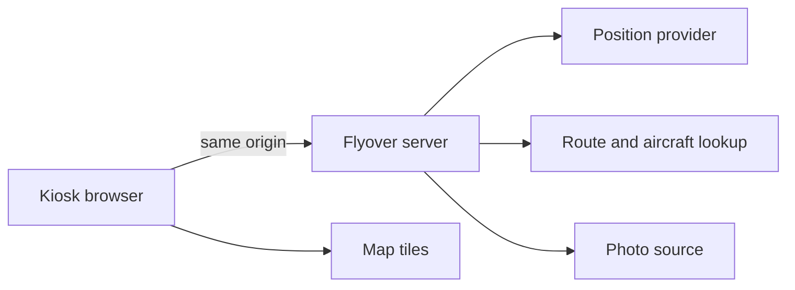

# Technical Requirements Document

**Project:** Flyover
**Version:** 0.1
**Status:** Draft
**Last Updated:** 2026-11-10
**PRD Reference:** [PRD](prd.md)

Terms below were read on 2026-11-10. They are not a legal opinion. The owner confirms them before any provider is enabled. Where a page could not be fetched, the gap is named.

---

## 1. Executive Summary

### Purpose

Describe a v1 Flyover that a kiosk browser can run against the owner's servers, fed by online flight data, without pretending a provider has been chosen or a stack has been accepted.

### Scope

In scope: the shape of the web app, the provider options and the licence risks, the data the server may keep, and the environment and failover requirements for `devserver1`, `stagingserver`, `webserver1`, and `webserver2`.

Out of scope: application code, host addresses beyond those four names, credentials, a radio receiver, and any cutover mechanism the owner has not described.

### Key Decisions

Only the decisions in [decisions.md](decisions.md) are accepted. Everything in the ADR section of this document is **Proposed**.

- v1 is the API web app. No extra hardware. (Accepted. See the decisions log.)
- The software licence is MIT. Upstream data terms are not. (Accepted.)
- One deployable web application, TypeScript, SQLite, and adsb.lol as the position source are **proposals**, gated on the open questions below.

---

## 2. Project Classification

**Project Type:** web_application

**Classification Rationale:** Flyover serves a browser UI. The browser is the product. A small server exists so that provider credentials and polling stay off the kiosk. That server is part of the same application, not a separate API product. Q1 of the SDLC Studio decision tree (does this serve a web frontend?) is yes.

**Architecture Implications:**

- **Default Pattern:** Monolith, from the web-application row of the pattern matrix. The start-simple rule applies: one owner, one deployment topology, a shared data model, no independent scaling need.
- **Pattern Used:** Monolith (proposed).
- **Deviation Rationale:** None. Microservices, a separate frontend deploy, and serverless are worse fits. A kiosk that polls every few seconds is a long-lived client of one process, not a function with a cold start. Two deployables would double the failover story across `webserver1` and `webserver2` for no current requirement.

---

## 3. Architecture Overview

### System Context



The kiosk never holds an upstream flight-data credential. Map tiles are requested by the browser from a tile host whose terms allow it. Which host is [TRD-OQ6](#12-open-technical-questions).

### Architecture Pattern

Monolith. One process serves the built UI and the Flyover API.

**Rationale:** The owner runs one application on `webserver1`, with `webserver2` holding the same application for failover. Splitting the UI and the poller would make failover two things that must move together. Internal modules still have boundaries: display, polling, enrichment, photos. Those are packages, not services.

### Component Overview

No paths exist yet. The names are the modules a later story would create.

| Component | Responsibility | Technology | Constraints |
|-----------|---------------|------------|-------------|
| Kiosk UI | List, detail, map, credits, empty and stale states | Browser, current Chromium as the named target | No upstream key. No hover-only control on the live view. Data age visible. Not-for-navigation statement visible. |
| Application server | Profile, poll, cache, same-origin API | Proposed TypeScript, one process | Rate-limit before the provider does. Refuse a provider the configuration has not explicitly enabled. |
| Position adapter | One interface, one enabled implementation | Proposed | Record the source name on every snapshot. Do not call a second provider to fill gaps unless that provider is also explicitly enabled. |
| Enrichment adapter | Airline, flight number, origin, destination, type | Proposed | A cache is not a republished route database. Unknown stays unknown. |
| Photo adapter | Thumbnail URL, credit, link | Proposed | Do not store image bytes. Do not show a photo without the credit and the link. |
| Operator config | Location, radius, secrets | On the host, outside git | No secret and no home coordinate in the repository. |

---

## 4. Technology Stack

### Core Technologies

| Category | Technology | Version | Rationale |
| ---------- | ----------- | --------- | ----------- |
| Language | TypeScript | Not pinned | The UI is the product, and the server must share types with it for the snapshot and the profile. Proposed, not accepted. [TRD-OQ1](#12-open-technical-questions). |
| Framework | Not chosen | — | A Vite-built UI served by one small HTTP server (Hono or Fastify are the candidates) keeps a kiosk from taking on a document-site framework. Next.js is the other web-app default in the architecture guide and remains an option. |
| Database | SQLite | Not pinned | The profile is small and the deployment is a single host. PostgreSQL is the usual production default and is not justified until more than one host must read the same profiles. Failover may change this. [TRD-OQ2](#12-open-technical-questions). |

Python with FastAPI is the other recommended web-app server. It was not proposed as the default because the kiosk UI would then be a second language and a second build. That trade is the owner's if they prefer Python. Familiarity alone is not the reason for TypeScript. The reason is one language across the only two parts v1 has.

### Build & Development

| Tool | Purpose |
|------|---------|
| Not chosen | No toolchain is selected while the stack question is open. The test strategy names the kinds of check, not the commands. |

### Infrastructure Services

| Service | Provider | Purpose |
|---------|----------|---------|
| Development | `devserver1` | Where the owner builds and runs the app |
| Staging | `stagingserver` | The same build, rehearsed before production |
| Production | `webserver1` | The live display |
| Production failover | `webserver2` | The same release, used when `webserver1` is unavailable |

No other provider is assumed. No container platform, no DNS host, and no secret store is named, because the owner has not named one.

---

## 5. API Contracts

### API Style

REST with JSON, between the kiosk and the Flyover server only. Upstream providers stay behind the server. OpenAPI is the documentation form when the server exists. Not built.

### Authentication

No end-user account in the proposal. The kiosk calls same-origin routes. Upstream credentials are server configuration. Whether setup itself is protected is [PRD-OQ7](prd.md#14-open-questions).

### Endpoints Overview

Illustrative. Not a commitment to paths.

| Method | Path | Description | Auth |
|--------|------|-------------|------|
| GET | `/api/snapshot` | Last accepted poll for the active profile: aircraft, ages, source names, credits | Unspecified. See PRD-OQ7 |
| GET | `/api/profile` | The non-secret profile the screen needs | Unspecified |
| PUT | `/api/profile` | Set location, radius, units | Unspecified. Must not be an open write on the public internet by accident |

### Error Response Format

```json
{
  "error": {
    "code": "ERROR_CODE",
    "message": "Human-readable message",
    "details": {}
  }
}
```

Provider failures are not this error. A dead upstream is a successful snapshot response with a stale or degraded flag, so the kiosk can keep painting. This envelope is for Flyover's own refusal (bad profile, provider not enabled).

---

## 6. Data Architecture

### Data Models

#### Display profile

| Field | Type | Constraints | Description |
|-------|------|-------------|-------------|
| id | text | Primary key | One row until PRD-OQ1 says otherwise |
| label | text | Optional | What the household calls this screen |
| latitude | number | -90 to 90 | Home |
| longitude | number | -180 to 180 | Home |
| radius_m | number | Greater than 0 | Great-circle radius |
| units | text | An allowed set | Open which set. PRD-OQ3 |

#### Aircraft snapshot

| Field | Type | Constraints | Description |
|-------|------|-------------|-------------|
| icao24 | text | From the feed | Stable aircraft id when present |
| callsign | text | Nullable | As broadcast |
| latitude, longitude | number | Required to be listed | Last accepted position |
| altitude | number | Nullable | As the feed defines it. Unit recorded |
| ground_speed | number | Nullable | As the feed defines it. Unit recorded |
| heading | number | Nullable | Track, if the feed has it |
| observed_at | timestamp | Required | When the source observed it |
| source | text | Required | Which provider |

Not stored as history. The server keeps the latest poll.

#### Enrichment cache

| Field | Type | Constraints | Description |
|-------|------|-------------|-------------|
| key | text | Identifier or callsign | Lookup key |
| airline, flight_number, origin, destination, aircraft_type | text | Each nullable | Absent means unknown |
| fetched_at | timestamp | Required | So a stale row can be dropped |
| source | text | Required | Which lookup |

This cache exists to avoid repeat lookups. It is not a database of routes offered to anyone else. If the source forbids incorporation into another database, the cache is either not written or is written only for the duration the source allows, and it is never exported. That condition is [TRD-OQ5](#12-open-technical-questions).

### Storage Strategy

| Data Type | Storage | Rationale |
|-----------|---------|-----------|
| Profile | SQLite on the host, proposed | Small, one writer, no extra service |
| Latest poll | Process memory | A history is a different product and a different licence question |
| Enrichment | SQLite with a TTL, proposed | Cuts repeat calls. Must not become a published route dump |
| Photo bytes | Not stored | The thumbnail is loaded from the source URL |
| Secrets | Host environment or a file outside the repo | Never in git |

### Migrations

None until there is a schema. When there is one, migrations ship with the same build that reads them, and a migration runs before the process serves traffic. No migration tool is chosen.

---

## 7. Integration Patterns

### External Services

Read on 2026-11-10. "Eligible" means the published terms do not obviously forbid a live display. It is not permission. The owner still accepts the source.

| Service | Purpose | Protocol | Auth | Licence and limits, as read | Commercial / live use | Attribution |
|---------|---------|----------|------|-----------------------------|------------------------|-------------|
| [adsb.lol API](https://www.adsb.lol/docs/open-data/api) | Live positions | HTTPS JSON, base `https://api.adsb.lol` | Optional key. The API repository says a key may later be required and is obtained by feeding | Data and API under the Open Database Licence 1.0, stated on the docs page and in the API service description. ODbL allows commercial use. Share-alike applies to a publicly used derivative database, not to merely showing a produced work. Rate limits are dynamic with load. No fixed number is published. The API description asks production users to make contact so a change does not break the application | Best fit of the sources read, for an MIT app someone besides the owner might run. Still a risk: the project can change the API, and production use is "please contact", not a contract | ODbL attribution. Credit adsb.lol and keep the licence notice |
| [OpenSky Network](https://opensky-network.org/about/terms-of-use) | Live positions | REST, documented at the [REST API manual](https://openskynetwork.github.io/opensky-api/rest.html) | Anonymous by IP, or an account. Anonymous is current data only, 10-second resolution | Anonymous quota 400 credits per day for each of `/states`, `/tracks`, and `/flights`. A `/states/all` box of at most 25 square degrees costs 1 credit. Global costs 4. Exhaustion is HTTP 429 with `X-Rate-Limit-Retry-After-Seconds`. Standard account 4,000 credits per day. Active feeder 8,000. The terms grant use for non-profit research and education | **Not eligible for this product without a written licence.** The terms require a written licence for any commercial or for-profit use, and for operational REST API use in any live product, service, or automated system, including by a non-profit. A kiosk that polls OpenSky is that operational use | If a licence is obtained, publications cite Schäfer et al., IPSN 2014, and opensky-network.org, as the terms specify |
| [ADS-B Exchange](https://www.adsbexchange.com/community/developer-hub/) community / RapidAPI | Live positions | REST via RapidAPI | API key | The RapidAPI listing's licence, as retrieved 2026-11-10, allows personal non-commercial research, non-profit education, or non-production internal testing. Redistribution, resale, and sublicensing are prohibited. The developer hub describes a personal-use plan and enterprise products. Enterprise pricing is not published. Re-check any price before relying on it | Community and personal-use plans are **not eligible** for a customer-facing or commercial deployment. Enterprise is a commercial contract the owner would have to request | As the contract requires. Not assumed |
| [adsbdb](https://www.adsbdb.com/) | Airline, route, aircraft type | HTTPS JSON `https://api.adsbdb.com/v0/` | None for reads | The site says the flight-route data is the work of David Taylor and Jim Mason and **may not be copied, published, or incorporated into other databases** without David J Taylor's permission. Rate limit, from the same page: in a rolling 60 seconds, 512 or more requests are blocked for 60 seconds, and 1,024 or more for 300 seconds. Aircraft photos on that API are credited to airport-data, whose terms were **not** read. Do not use those photo URLs until they are | Display of a looked-up route may be allowed and a stored route database may not. Treat a durable cache as the risky case. [TRD-OQ5](#12-open-technical-questions) | Credit the route authors and adsbdb if the owner is allowed to use the data |
| [Planespotters](https://www.planespotters.net/legal/termsofuse) | Airframe photo | The public photo API page (`/photo/api`) returned an error on 2026-11-10 and was **not** read | Unknown until that page is read | The terms of use forbid copying or publishing photos without the author's permission, and they say thumbnails supplied to partner sites carry the author credit and a link back to the photo. Integrator write-ups describe a keyless thumbnail API, a ban on re-hosting, and a 24-hour cap on caching the JSON. Those write-ups are not the terms. [TRD-OQ7](#12-open-technical-questions) | Do not enable photos until the API conditions are read from Planespotters. A photo behind a paywall would violate the "freely accessible" condition integrators report, so v1 must not put photos behind a login even if the rest of the app gains one | Photographer name and a link, if photos are enabled |
| Map tiles | Basemap | HTTPS tiles or a vector style | Depends on the host | The OpenStreetMap Foundation's public tile servers are operated for light, human use of the project, not for a kiosk that loads tiles all day. Flyover must not point a kiosk at `tile.openstreetmap.org` | Use a provider or a self-hosted style the owner is allowed to hammer. [TRD-OQ6](#12-open-technical-questions) | Whatever that host requires. OpenStreetMap data itself is ODbL |
| Geocoder | One-shot address to coordinates, only if PRD-OQ2 asks for it | HTTPS | None assumed | Not selected. A public Nominatim instance has a usage policy of its own. One lookup at setup is a different load from the position poll | Out of the live loop | As that service requires |
| Local `dump1090` / `readsb` | Positions from a receiver in the house | Not in v1 | — | Future adapter only. Named so the position interface does not assume a single HTTP vendor forever | The owner's own receiver is their data. Out of scope for this version | Not applicable in v1 |

Other commercial flight APIs exist. Prices were not copied from third-party roundups. If the owner wants a contracted feed, that is a procurement choice, not a default.

### Event Architecture

None. The server polls. The kiosk polls the server, or the server pushes over one connection later if polling the server proves noisy. Polling is enough for v1 and is easier to test. A push channel is not a requirement.

### Risks, called out together

1. **OpenSky looks free and is the wrong default.** Operational use of the REST API in a live product needs a written licence even for a non-profit. Using it in Flyover without that licence is a licence breach, not a technical shortcut.
2. **ADS-B Exchange community data is non-commercial.** An MIT repository that anyone can run is an awkward fit for a personal-use-only feed.
3. **adsb.lol is the least-restricted position source read so far, and it is still a single volunteer service** with dynamic limits and a request that production users make contact. It can go away or start requiring a feed.
4. **ODbL share-alike is about databases, not about the screen.** Publishing a derived position or route database would obligate that database's licence. v1 does not publish one. A later "export tracks" feature would reopen this.
5. **adsbdb routes cannot be poured into another database** without permission. A convenient SQLite of every callsign seen is the thing the notice forbids.
6. **Photos are other people's copyright.** Re-hosting them, dropping the credit, or putting them behind a paywall are the failures.
7. **The home location leaks by the query.** A tight bounding box sent to a third party is close to the address. The server should query a box no tighter than it needs, and it should not log the profile at info level on every poll.
8. **MIT does not flow upstream.** README and the about-credits on the screen have to say so.

---

## 8. Infrastructure

### Deployment Topology

One build. The owner runs that build on each server. Production traffic uses `webserver1`. `webserver2` runs the same release and is the failover. Nothing in this document invents an IP, a DNS name, a port, or a credential.

The kiosk is not deployed by Flyover. It is a browser the household points at the URL.

### Environment Strategy

| Environment | Purpose | Characteristics |
| ------------- | --------- | ----------------- |
| Development | Build and try the app | Host `devserver1`. Disposable data. No production provider key unless the owner deliberately uses one |
| Staging | Rehearse the release | Host `stagingserver`. Same artefact as production. Not the live screen |
| Production | The display the household watches | Host `webserver1` |
| Production failover | Stand-in when `webserver1` is down | Host `webserver2`. Same release as `webserver1` |

Promotion is dev, then staging, then the production pair. The owner triggers production. The skill's deploy step is not authorised to do it, and this TRD does not give it a command.

### Failover

Requirements, not a design:

- `webserver2` can serve the same Flyover build `webserver1` serves.
- When `webserver1` is unavailable, the display is reachable via `webserver2` without a code change.
- Failover does not require a position archive. Losing the in-memory poll means the next poll refills the screen.
- The profile must exist on the host that serves traffic. If the profile lives only on `webserver1`'s disk, `webserver2` cannot fail over. That is why [TRD-OQ2](#12-open-technical-questions) is open.
- How traffic moves (DNS, a proxy the owner already has, or a manual change) is [TRD-OQ3](#12-open-technical-questions). This document does not pick one.

### Scaling Strategy

Vertical, in the trivial sense: one process on one host is enough for a handful of kiosks reading one cached poll. Do not add a second service to scale. The upstream rate limit is the scaling constraint that matters, and caching the poll is how one kiosk and three kiosks cost the same upstream calls.

---

## 9. Security Considerations

### Threat Model

| Threat | Likelihood | Impact | Mitigation |
|--------|-----------|--------|------------|
| Provider key committed or sent to the browser | Medium if someone is careless | High. The key is the quota, and sometimes the licence | Keys only in host config. Browser talks to Flyover. Review any client bundle for the key |
| Home location in logs, backups, or a too-tight upstream box | Medium | High. It is the household's address | Do not log the profile on the poll path. Query a box, not a street. No location in git |
| Unauthenticated setup on the public internet | Unknown until PRD-OQ7 | High. Anyone could retarget the display or read the location | Setup write is not exposed until the owner says who may call it |
| Stale or empty feed shown as live | High, because feeds fail | Medium. The household trusts a lie | Age on screen. Distinct empty, stale, and down states. PRD feature "Honest emptiness" |
| Photo or route used outside its terms | Medium | High, legally | Providers off until enabled. Photo bytes not stored. Route cache policy follows TRD-OQ5 |
| Treating the screen as navigation | Low technically, high if the copy is casual | High | The not-for-navigation statement is a requirement, not a footer afterthought |

### Security Controls

| Control | Implementation |
| --------- | ---------------- |
| Authentication | No end-user account proposed. Upstream auth stays on the server. Setup exposure is an open question |
| Authorisation | One operator. No roles until there is more than one profile with different people |
| Encryption at rest | Not specified. The profile is a location. Disk encryption of the host, if any, is the owner's existing practice and is not invented here |
| Encryption in transit | The kiosk should reach Flyover over HTTPS in production. Where TLS terminates is [TRD-OQ9](#12-open-technical-questions). Upstream calls are HTTPS |

No sector compliance regime is declared. Home location is personal data. Whether UK GDPR or another regime applies is [TRD-OQ8](#12-open-technical-questions). The engineering consequence that does not wait for that answer: collect only the location the display needs, do not send it to a provider as a street address, and do not keep a history of who looked at the screen. There is no "who looked" record in v1.

---

## 10. Performance Requirements

### Targets

Proposed. The owner can replace the numbers via PRD-OQ5. They are not a benchmark result.

| Metric | Target | Measurement |
| -------- | -------- | ------------- |
| Snapshot freshness on screen | Within 15 seconds of a successful poll | Time from the server accepting a poll to the kiosk showing it, on the named browser |
| Stale label | Older than 60 seconds | The age shown on the screen, from `observed_at` |
| Poll cost | Inside the enabled provider's published limit, with margin | Count of upstream calls per minute against that provider's documented threshold |
| Availability | No percentage | A failed upstream still paints empty, stale, or degraded. Failover is a hosting requirement, not this number |

---

## 11. Architecture Decision Records

Proposed. Not accepted. Accepting one is an owner decision, recorded with `decisions.py add`, not by editing the status word here and nowhere else.

### ADR-001: One deployable web application

**Status:** Proposed

**Context:** The architecture guide's default for a web application on a small team is a monolith. Flyover has one UI, one poller, and two hosts that must run the same thing.

**Decision:** One process serves the UI and the API. Modules communicate in-process.

**Consequences:**

- Positive: Failover copies one build. One test suite. Credentials stay in one place.
- Negative: The UI and the poller ship together even when only one changed.

### ADR-002: No position provider is enabled by default

**Status:** Proposed

**Context:** The eligible sources do not agree. OpenSky's terms forbid this use without a written licence. ADS-B Exchange's community terms are non-commercial. adsb.lol is ODbL and asks production users to make contact.

**Decision:** The adapter interface exists. The configuration must name the provider before any call is made. The recommendation, if the owner wants a source that permits a live open-source display, is adsb.lol, after the owner contacts the project. It is not a silent default.

**Consequences:**

- Positive: The app cannot boot into a licence breach.
- Negative: A fresh checkout shows no aircraft until the owner chooses.

### ADR-003: Do not store a position history in v1

**Status:** Proposed

**Context:** A trail is attractive and turns the server into a database of movements. ODbL share-alike and retention both get sharper once that database is kept or published.

**Decision:** Keep the latest poll in memory. Enrichment cache is keyed and expired, and is not an export.

**Consequences:**

- Positive: Failover loses nothing that matters. The licence surface stays small.
- Negative: No "where was it a minute ago" unless a later version reopens the decision.

### ADR-004: The browser does not call flight-data APIs

**Status:** Proposed

**Context:** A key in the kiosk is a key on every screen, and a browser cannot be trusted to keep a home coordinate out of a third-party URL.

**Decision:** The kiosk calls Flyover. Flyover calls the providers.

**Consequences:**

- Positive: Keys and the tightest query stay on the server.
- Negative: The server must be up for the screen to be up. That is already true of the hosting plan.

### ADR-005: SQLite until failover needs a shared profile

**Status:** Proposed

**Context:** One host, one profile, no transactions across services. PostgreSQL would be another thing `webserver2` must reach.

**Decision:** SQLite for the profile and the enrichment TTL, on the host that serves. If failover requires the profile to exist on both hosts, either the profile is deployed with the config (not in git) or the owner names a store both hosts can read. Do not introduce PostgreSQL speculatively.

**Consequences:**

- Positive: No database service to operate.
- Negative: Two disks do not share a SQLite file. [TRD-OQ2](#12-open-technical-questions) remains open.

---

## 12. Open Technical Questions

- [ ] **TRD-OQ1:** Accept TypeScript as one process (UI plus server), or name another stack?
  **Context:** The proposal is one language because the UI and the poller share a snapshot type. Python plus a separate UI is the main alternative. No application code should be written until this is answered.

- [ ] **TRD-OQ2:** Where does the display profile live so that `webserver2` can serve it when `webserver1` cannot?
  **Context:** SQLite on one disk does not fail over. A profile shipped as host config (still outside git) might. A shared database might. This document does not invent the mechanism.

- [ ] **TRD-OQ3:** How does traffic move from `webserver1` to `webserver2`?
  **Context:** DNS, an existing proxy, or a manual step are all possible. None is documented by the owner. No IP or hostname beyond the four server names is known.

- [ ] **TRD-OQ4:** Which position provider, if any, will the owner enable?
  **Context:** Recommendation is adsb.lol after contact, and only if [PRD-OQ8](prd.md#14-open-questions) allows that licence. OpenSky requires a written licence for this use. ADS-B Exchange community data does not cover a commercial or customer-facing deployment.
  **Options:** adsb.lol. OpenSky with a written licence. ADS-B Exchange enterprise. Another contracted feed. None until later.

- [ ] **TRD-OQ5:** May Flyover cache adsbdb route rows long enough to display them, or is permission from David J Taylor required first?
  **Context:** The site forbids copying the routes into another database without permission. A TTL cache for display is the grey edge. Do not enable route enrichment until the owner decides.

- [ ] **TRD-OQ6:** Which map tile or style host may a kiosk load all day?
  **Context:** The public OpenStreetMap tile servers are not that host.

- [ ] **TRD-OQ7:** What does the Planespotters photo API require?
  **Context:** The terms of use were read. The API page was not, on 2026-11-10. Photos stay off until it is read. airport-data, credited by adsbdb for photos, was not read either and is not a candidate until it is.

- [ ] **TRD-OQ8:** Does a home location stored on the owner's server bring a privacy regime (for example UK GDPR) into scope?
  **Context:** No regime was declared. The data minimisation in the security section stands either way.

- [ ] **TRD-OQ9:** Where does TLS for the kiosk terminate, and how are provider secrets provided on each server?
  **Context:** Required behaviour is HTTPS in production and secrets outside git. The mechanism is the owner's. Do not invent a secret manager.

- [ ] **TRD-OQ10:** Is there a CI system that should run the future test gate, or does the owner run it on `devserver1`?
  **Context:** The test strategy describes the stages. It does not add a workflow file.

---

## 13. Implementation Constraints

### Must Have

- No application code in the discovery revision.
- No provider calls until that provider is explicitly enabled.
- No credentials, home coordinates, or extra hostnames in the repository.
- Credits on the screen for every source that is enabled.
- A local ADS-B receiver is not required and is not implemented in v1.

### Won't Have (This Version)

- Radio hardware, `dump1090`, `readsb`, or a custom frame.
- A position archive, alerts, dispatch, or anything a crew would use operationally.
- Copied airline logos.
- User accounts, unless PRD-OQ7 is answered by adding one.
- A second deployed service.

---

## Changelog

| Date | Version | Changes |
|------|---------|---------|
| 2026-11-10 | 0.1 | Initial draft. Provider terms cited from pages retrieved that day. Stack and provider are proposed, not accepted. |
